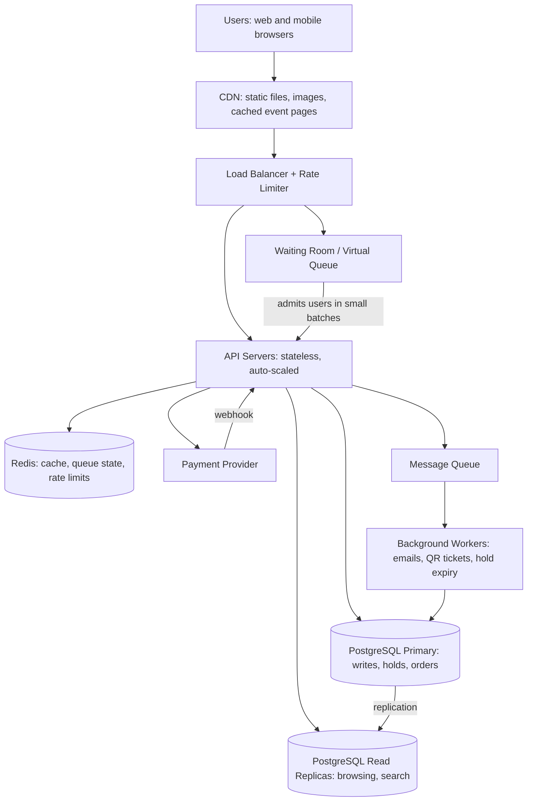

# TicketHub: Event Ticketing System Design

TicketHub is a website that sells tickets for concerts and events. This document follows the six-part framework: requirements, estimates, API, data model, architecture, and trade-offs. It also explains in detail how the design prevents two people from buying the same seat.

---

## 1. Requirements

### Functional requirements

1. Users can register, log in and log out.
2. Users can browse and search events (by name, date, city, category).
3. Users can view an event's details and its seat map with live availability.
4. Users can select one or more seats (maximum 6 per order) and **hold** them for a short time (5 minutes) while they pay.
5. Users can pay for held seats and receive a confirmation.
6. Users can view their tickets (with a QR code) and past orders.
7. Held seats that are not paid for are released automatically when the hold expires.
8. Organisers/admins can create events and set prices (out of scope for the detailed design).

### Non-functional requirements

| Quality | Requirement |
|---|---|
| **Speed** | Browsing pages respond in under 300 ms (95th percentile). Seat map loads in under 1 s. Holding a seat responds in under 500 ms, even during a big sale. |
| **Correctness** | A seat is **never** sold to two people. A user is never charged for a seat they do not receive. Every successful payment results in exactly one set of tickets (no duplicates if the payment callback is retried). |
| **Fairness** | During a big sale, people are served in the order they arrived. One person cannot grab all seats with bots or many tabs (per-user limit, rate limiting, queue). |
| **Availability** | Browsing stays up even if payments or the database are slow. Target 99.9% uptime, and especially during a sale. |
| **Scalability** | Handles normal days cheaply and survives a spike of about 500 times normal load without crashing. |
| **Security** | Passwords hashed, HTTPS everywhere, card details handled only by the payment provider (we never store them). |
| **Durability** | Once an order is confirmed, it is never lost (database backups and replication). |

---

## 2. Estimates

Given facts: 2,000,000 registered users; 50,000 visitors on a normal day, each viewing 10 pages; 5,000 tickets sold on a normal day; during a popular sale, 200,000 people try to buy 20,000 seats in the first 10 minutes.

### Normal day

- Page views per day: 50,000 × 10 = **500,000**
- Average rate: 500,000 / 86,400 seconds ≈ **6 requests per second**
- Visits are not spread evenly, so assume the busiest hour is about 10 times the average: **about 60 requests per second at peak**
- Tickets sold: 5,000 / 86,400 ≈ **0.06 per second** (one every 17 seconds on average)
- Storage: 5,000 tickets per day ≈ 1.8 million per year. At roughly 200 bytes per row this is under 1 GB per year. Seats are stored per event: 20,000 seats × about 1,000 events per year = 20 million rows, which a single PostgreSQL database handles comfortably.

A normal day is easy: one small database and two or three servers are enough.

### Big sale (popular concert)

- 200,000 users in 10 minutes (600 s) = about **333 new users per second** arriving
- Each user makes roughly 10 requests in the window (open page, load seat map, refresh seat map a few times, try to hold, pay): 200,000 × 10 = 2,000,000 requests / 600 s ≈ **3,300 requests per second on average**
- Traffic is front-loaded (everyone arrives at the moment sales open), so assume a peak of about 3× the average: **about 10,000 requests per second**
- Seat hold attempts: say 3 attempts per user = 600,000 attempts / 600 s ≈ **1,000 hold attempts per second**, all fighting over the same 20,000 rows
- Seats sold: 20,000 in 10 minutes = **about 33 sales per second**
- Demand versus supply: 200,000 / 20,000 = **10 people per seat**, so 90% of users will not get a ticket. The system must fail gracefully for them ("sold out") and stay fair.

### Comparison

| Measure | Normal day | Big sale | Increase |
|---|---|---|---|
| Average requests/sec | about 6 (peak hour about 60) | about 3,300 (peak about 10,000) | about 550× average |
| Tickets sold/sec | 0.06 | 33 | about 550× |
| Users competing for the same rows | almost none | 200,000 for 20,000 seats | extreme contention |

The big sale is roughly **500 times** heavier than a normal day, concentrated on one event and a few thousand rows. We cannot simply "buy bigger servers" for a 10-minute spike, so the design must **absorb the spike** (CDN, cache, queue) and **protect the database** (only let in as many people as it can handle).

---

## 3. API Design

REST over HTTPS, JSON bodies. All endpoints except browsing and login require `Authorization: Bearer <token>`.

### Endpoints

| # | Method and path | Purpose |
|---|---|---|
| 1 | `POST /auth/register`, `POST /auth/login` | Create an account / obtain a token |
| 2 | `GET /events?city=&category=&date=&page=` | Browse and search events |
| 3 | `GET /events/{eventId}` | Event details (artist, venue, date, price tiers) |
| 4 | `GET /events/{eventId}/seats?section=` | View seats with their status (available / held / sold) |
| 5 | `POST /events/{eventId}/holds` | Hold chosen seats for 5 minutes |
| 6 | `DELETE /holds/{holdId}` | Release a hold (user changes their mind) |
| 7 | `POST /orders` | Pay for a hold and create the order |
| 8 | `GET /me/tickets` | View my tickets |
| 9 | `GET /me/orders/{orderId}` | View one order and its status |

### Key examples

**Browse events**
```
GET /events?city=Mbabane&category=concert&page=1
200 OK
{ "items": [ { "id": 42, "name": "Summer Fest", "date": "2026-12-05T18:00:00Z",
               "venue": "Somhlolo Stadium", "fromPrice": 150.00 } ],
  "page": 1, "totalPages": 7 }
```

**View seats**
```
GET /events/42/seats?section=A
200 OK
{ "eventId": 42,
  "seats": [ { "seatId": 1001, "row": "A", "number": 1, "price": 300.00, "status": "AVAILABLE" },
             { "seatId": 1002, "row": "A", "number": 2, "price": 300.00, "status": "HELD" },
             { "seatId": 1003, "row": "A", "number": 3, "price": 300.00, "status": "SOLD" } ],
  "asOf": "2026-12-01T10:00:03Z" }
```
This is a *view*: it may be a few seconds old. The real decision is made when holding.

**Hold seats**
```
POST /events/42/holds
Headers: Idempotency-Key: 7d1c...
Body: { "seatIds": [1001, 1004] }

201 Created
{ "holdId": "h_8f3a", "seatIds": [1001, 1004], "expiresAt": "2026-12-01T10:05:03Z" }

409 Conflict   (one or more seats are taken; nothing is held)
{ "error": "SEAT_UNAVAILABLE", "unavailableSeatIds": [1004] }

429 Too Many Requests   (rate limit or queue not yet admitted)
```

**Pay**
```
POST /orders
Headers: Idempotency-Key: 91ab...
Body: { "holdId": "h_8f3a", "paymentMethodToken": "tok_abc" }

201 Created
{ "orderId": 5521, "status": "PAID", "tickets": [ { "ticketId": 9001, "seatId": 1001 }, ... ] }

410 Gone       (hold expired)
402 Payment Required   (payment failed, hold stays until it expires)
```

**My tickets**
```
GET /me/tickets
200 OK
[ { "ticketId": 9001, "event": "Summer Fest", "seat": "A-1", "qrCode": "...", "orderId": 5521 } ]
```

### Notes on API design

- **Holding and paying are separate steps** so the user has time to pay without the seat being sold from under them.
- **Idempotency keys** on `POST /holds` and `POST /orders` mean that a double-click or network retry cannot create two holds or charge twice.
- Holds are **all or nothing**: if one of three seats is taken, none are held, and the response says which one failed.

---

## 4. Data Model

PostgreSQL (relational) because correctness, transactions and constraints are the most important requirements.

### Tables

**users**

| Column | Type | Notes |
|---|---|---|
| id | BIGINT PK | |
| email | VARCHAR UNIQUE NOT NULL | |
| password_hash | VARCHAR NOT NULL | |
| name | VARCHAR | |
| created_at | TIMESTAMPTZ | |

**venues**

| Column | Type | Notes |
|---|---|---|
| id | BIGINT PK | |
| name, city, address | VARCHAR | |
| capacity | INT | |

**events**

| Column | Type | Notes |
|---|---|---|
| id | BIGINT PK | |
| venue_id | BIGINT FK → venues.id | |
| name, category | VARCHAR | |
| starts_at | TIMESTAMPTZ | indexed |
| sale_starts_at | TIMESTAMPTZ | when tickets go on sale |
| status | VARCHAR | DRAFT / ON_SALE / SOLD_OUT / CANCELLED |

**event_seats** (one row per seat per event; this is the table everyone competes for)

| Column | Type | Notes |
|---|---|---|
| id | BIGINT PK | |
| event_id | BIGINT FK → events.id | |
| section, row_label, seat_number | VARCHAR / INT | |
| price | NUMERIC(10,2) | |
| status | VARCHAR | AVAILABLE / HELD / SOLD, with a CHECK constraint |
| held_by_user_id | BIGINT FK → users.id NULL | who holds it |
| hold_id | UUID NULL | groups the seats of one hold |
| hold_expires_at | TIMESTAMPTZ NULL | |
| version | INT | incremented on every change |
| **UNIQUE (event_id, section, row_label, seat_number)** | | a seat exists only once per event |

Indexes: `(event_id, status)` for the seat map; `(hold_expires_at) WHERE status = 'HELD'` for the expiry job.

**orders**

| Column | Type | Notes |
|---|---|---|
| id | BIGINT PK | |
| user_id | BIGINT FK → users.id | |
| event_id | BIGINT FK → events.id | |
| total_amount | NUMERIC(10,2) | |
| status | VARCHAR | PENDING / PAID / FAILED / REFUNDED |
| payment_reference | VARCHAR UNIQUE | from the payment provider, prevents double processing |
| idempotency_key | VARCHAR UNIQUE | |
| created_at | TIMESTAMPTZ | |

**tickets**

| Column | Type | Notes |
|---|---|---|
| id | BIGINT PK | |
| order_id | BIGINT FK → orders.id | |
| event_id | BIGINT FK → events.id | |
| event_seat_id | BIGINT FK → event_seats.id | |
| qr_code | VARCHAR UNIQUE | |
| **UNIQUE (event_seat_id)** | | **a seat can be on at most one ticket** |

### Relationships

```
users 1 ──< orders 1 ──< tickets >── 1 event_seats >──1 events >── 1 venues
users 1 ──< event_seats (held_by_user_id, only while held)
events 1 ──< orders
```

- One user has many orders; one order has many tickets.
- One event has many event_seats; one venue hosts many events.
- Each ticket points to exactly one event_seat, and each event_seat appears on at most one ticket (enforced by the UNIQUE constraint).

---

## 5. How the Design Prevents Double-Booking

Two people clicking the same seat at the same millisecond is the central correctness problem. A "check, then update" approach is **wrong**:

```
-- BROKEN: race condition
SELECT status FROM event_seats WHERE id = 1001;   -- both users see AVAILABLE
UPDATE event_seats SET status = 'HELD' ...;       -- both succeed, seat double-booked
```

Between the SELECT and the UPDATE, another request can sneak in. We use **three layers of defence**.

### Layer 1: One atomic conditional UPDATE inside a transaction (hold)

Checking and changing happen in a single statement, so the database does both as one step:

```sql
BEGIN;

UPDATE event_seats
SET    status = 'HELD',
       held_by_user_id = :userId,
       hold_id = :holdId,
       hold_expires_at = now() + interval '5 minutes',
       version = version + 1
WHERE  event_id = :eventId
  AND  id IN (:seatIds)            -- processed in sorted order
  AND  (status = 'AVAILABLE'
        OR (status = 'HELD' AND hold_expires_at < now()));   -- expired holds can be taken

-- If rows affected != number of seats requested, at least one seat was taken:
--   ROLLBACK, return 409 (all or nothing).
COMMIT;
```

PostgreSQL locks a row while updating it. If two users run this for seat 1001 at the same time, the second one **waits** for the first to finish, then re-checks the `WHERE` condition, sees `status = 'HELD'`, and updates **0 rows**. Exactly one user wins, and the loser gets a clean 409. The transaction guarantees that either all requested seats are held, or none are. Seats are always locked in sorted order (`ORDER BY id`) so two users picking overlapping seats in different orders cannot deadlock.

### Layer 2: Re-check at payment time (still in a transaction)

Holds expire, so before confirming a payment we verify the user still owns the seats:

```sql
BEGIN;
UPDATE event_seats
SET    status = 'SOLD', version = version + 1
WHERE  hold_id = :holdId AND held_by_user_id = :userId
  AND  status = 'HELD' AND hold_expires_at > now();
-- rows affected must equal the number of seats in the hold, otherwise ROLLBACK (410 Gone)

INSERT INTO orders (...) VALUES (...);
INSERT INTO tickets (order_id, event_seat_id, ...) SELECT ... ;
COMMIT;
```

Setting the seat to SOLD, creating the order and creating the tickets are in **one transaction**, so we never end up with a sold seat and no ticket, or a ticket with no sold seat.

### Layer 3: Database constraints as the last safety net

Even if there were a bug in the application code, the database refuses to store a double sale:

- `UNIQUE (event_seat_id)` on `tickets`: a second ticket for the same seat fails with a constraint error.
- `UNIQUE (event_id, section, row_label, seat_number)` on `event_seats`: no duplicate seat rows.
- `UNIQUE (payment_reference)` and `UNIQUE (idempotency_key)` on `orders`: a retried payment callback cannot create a second order.
- `CHECK (status IN ('AVAILABLE','HELD','SOLD'))`.

### Expiry of holds

A background worker runs every 30 seconds and releases holds that expired (`status = 'AVAILABLE'`, clearing `held_by_user_id`, `hold_id`, `hold_expires_at`). Because Layer 1 also treats an expired hold as available, correctness does not depend on the worker being on time. The worker only keeps the seat map tidy.

### What about the cache?

The seat map shown to users comes from a cache and may be a few seconds stale. That is fine, because **the cache never decides who gets a seat**. Only the database transaction decides. A stale "available" seat simply results in a 409 and the user picks another.

---

## 6. Architecture



### Components

| Component | What it does | Why it is there |
|---|---|---|
| **CDN** | Serves images, JavaScript, CSS and cached event pages from servers near the user. | Most of the 10 pages per visit are static or rarely change. The CDN absorbs the bulk of read traffic so our servers never see it. |
| **Load balancer and rate limiter** | Spreads requests across API servers; limits requests per user/IP. | No single server is overloaded, and bots cannot flood the system (fairness). |
| **Waiting room (virtual queue)** | When a popular sale opens, users get a queue position and are let into the buying flow at a controlled speed (for example 500 per second). Backed by Redis. | Protects the database from 200,000 simultaneous buyers. It also makes the sale fair: first come, first served. |
| **API servers** | Stateless application servers that validate requests and run the business logic (browse, hold, order). | Stateless means we can add more servers in minutes before a big sale. |
| **Redis** | Caches event details and seat maps (1 to 2 second expiry), stores queue positions and rate-limit counters. | Takes seat-map reads off the database. Very fast, in memory. It is **not** the source of truth for seats. |
| **PostgreSQL primary** | Stores users, events, seats, orders and tickets. Runs the hold and payment transactions. | ACID transactions and constraints give us correctness (Section 5). |
| **PostgreSQL read replicas** | Copies of the database used for browsing and search. | Reads scale out without touching the primary that handles the critical writes. |
| **Payment provider** | External service that charges the card and calls our webhook. | We never handle raw card data. The webhook is idempotent. |
| **Message queue and workers** | Handle slow, non-urgent work: confirmation emails, QR code generation, expiring holds, refunds. | The user gets a fast response; slow work happens in the background and can be retried. |

### How it survives the big sale

1. **Before the sale:** event pages and the seat layout are cached at the CDN and Redis. Extra API servers and replicas are scaled up in advance, since the sale time is known.
2. **At the start (333 new users per second, about 10,000 requests per second at peak):** the CDN serves static content, the rate limiter blocks bots and the waiting room admits users in controlled batches. Most of the spike is handled before it reaches the database.
3. **Seat map reads:** answered from Redis (refreshed every 1 to 2 seconds) rather than from the database, so thousands of people refreshing the map cost almost nothing.
4. **Hold attempts (about 1,000 per second):** each is one short transaction touching a few rows by primary key, which PostgreSQL can handle at this rate. Row-level locks mean different seats do not block each other.
5. **Payments:** the user has a 5-minute hold, so payment traffic is spread out and the slow external provider never blocks the database (no transaction stays open while waiting for the payment provider).
6. **Failure handling:** if the payment provider is slow, browsing and holding still work. If a worker fails, the queue retries. If the hold expires, the seat returns to the pool and the next person in the queue can buy it.
7. **After the sale:** 20,000 seats sold, the remaining 180,000 users see "sold out" quickly from the cache, which stops useless retries.

---

## 7. Trade-offs

### Trade-off 1: Strong consistency for seats versus raw speed

- **Choice:** the seat's status lives in PostgreSQL and every hold is a real transaction. We could have made holds faster by using only Redis (in-memory) and writing to the database later.
- **What we gain:** correctness. Money and unique seats are involved, so the database is the single source of truth with constraints as a safety net.
- **What we give up:** throughput. A transaction on the primary is slower than a Redis command, and the primary is a single write point that is harder to scale than a cache.
- **Why it is acceptable:** the peak is about 1,000 holds per second, which a single well-indexed PostgreSQL primary can handle. If it were 100,000 per second, we would shard by event or move the hold step to Redis with the database as the final authority.

### Trade-off 2: Waiting room (fairness and stability) versus user experience

- **Choice:** during a big sale, users enter a virtual queue and are admitted gradually.
- **What we gain:** a fair, first-come-first-served order, a protected database, and no crash from 200,000 simultaneous users.
- **What we give up:** some users wait several minutes and may get frustrated. It also adds one more component to build and operate.
- **Why it is acceptable:** a controlled wait is better than a website that crashes or gives seats to whoever has the fastest bot. Normal sales skip the queue.

### Trade-off 3: Cached seat map (stale data) versus live accuracy

- **Choice:** the seat map is cached for 1 to 2 seconds.
- **What we gain:** thousands of refreshes per second never reach the database.
- **What we give up:** a user may click a seat that was taken one second ago and receive a 409 "seat unavailable" error.
- **Why it is acceptable:** the hold transaction is always the real check, so a stale cache can only cause a small inconvenience, never a double-booking. The page can also highlight the failed seat and let the user pick another quickly.

### Trade-off 4: Hold duration (5 minutes)

- **Short hold:** seats return to the pool quickly, so more people get a chance, but a slow payer may lose the seat.
- **Long hold:** a calmer checkout, but bots or abandoned carts can lock seats and make the event look sold out when it is not.
- **Choice:** 5 minutes, with a limit of 6 seats per user and a visible countdown timer. This can be tuned per event.

### Trade-off 5: Single database versus microservices

- **Choice:** one PostgreSQL database and a single (modular) API application.
- **What we gain:** simple transactions across seats, orders and tickets, which is exactly what correctness needs, and less operational work.
- **What we give up:** harder independent scaling of each part later.
- **Why it is acceptable:** the numbers fit a single primary with replicas, and splitting into services would turn one simple transaction into a complicated distributed one.

---

## Summary

TicketHub is read-heavy on normal days (about 6 requests per second) and becomes write-contended during a big sale (about 3,300 per second, with 10 people per seat). The design keeps correctness in PostgreSQL (atomic conditional updates, transactions and UNIQUE constraints), and protects it with a CDN, Redis cache, rate limiter and waiting room, so the spike is absorbed before it can hurt the database and no seat is ever sold twice.
